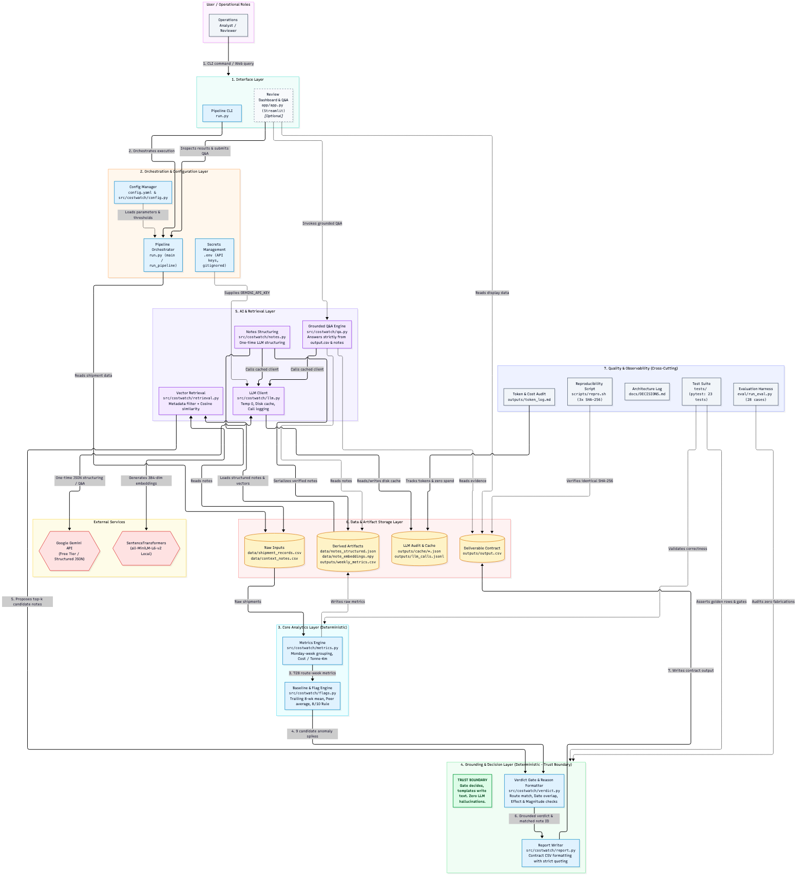

# Routewatch: Smart Shipping-Cost Assistant

An AI-powered anomaly detection and grounding system for Indian road freight. It monitors weekly freight costs per tonne-km across commercial routes, flags abnormal cost surges, checks verified real-world context notes (fuel changes, flood detours, festival surcharges), and provides plain-English, zero-hallucination explanations.



*For detailed layer breakdown, request flows, and decision gate diagrams, see [docs/ARCHITECTURE.md](docs/ARCHITECTURE.md).*

---

## Quick Start (Run in 3 Commands)

```bash
# 1. Clone & enter repository
git clone https://github.com/getdownandcode/Routewatch.git && cd Routewatch

# 2. Set up virtual environment and install dependencies
python3.12 -m venv .venv && source .venv/bin/activate
pip install -r requirements.txt

# 3. Run the end-to-end pipeline
python run.py
```
Outputs are written to:
- `outputs/output.csv` (anomalies with verified verdicts matching the exact contract)
- `outputs/weekly_metrics.csv` (all 728 route-weeks)

To run the full test suite and reproducibility check:
```bash
pytest tests/
./scripts/repro.sh
python eval/run_eval.py
```

---

## Core Metrics & Mathematical Definitions

1. **Week Grouping (`week_of`)**:
   - Every shipment date is grouped into Monday–Sunday weeks. `week_of` is the Monday date (`YYYY-MM-DD`).
2. **Cost per Tonne-Km**:
   $$\text{Cost per Tonne-Km} = \frac{\sum \text{Freight Cost (INR)}}{\sum (\text{Quantity (Tonnes)} \times \text{Distance (km)})}$$
   Computed with unrounded weighted sums: `sum(freight_cost_inr) / sum(quantity_tonnes * distance_km)`; displayed rounded to 2 decimal places.
3. **Vs. Own History (`vs_own_history`)**:
   - Trailing rolling mean over the **previous up-to-8 weeks**, strictly prior to the current week (zero look-ahead).
   - If fewer than 8 prior weeks exist, all available prior weeks are averaged without padding or extrapolation. Week 1 has no history (`N/A`) and cannot be flagged.
   - Percentage difference:
     $$\text{vs}_{\text{own}} = \left(\frac{\text{Current Rate}}{\text{Own Rolling Baseline}} - 1\right) \times 100\%$$
     Formatted as `+35.5% vs this route's past average`.
4. **Vs. Similar Routes (`vs_similar_routes`)**:
   - Average cost per tonne-km in that same week across all other routes sharing the same `route_type` (*Short*, *Medium*, or *Long*).
   - The route itself is strictly excluded from its peer average.
   - Formatted as `+21.0% vs similar-length routes this week`.

---

## Flagging Rules & Threshold Defense

A route-week is flagged as a candidate anomaly when:
1. `vs_own >= +8.0%` (roughly a $2\sigma$ deviation given $\sim 4.0\%$ historical route volatility), **AND**
2. `vs_similar >= +10.0%` (eliminates peer-level market-wide fluctuations), **AND**
3. At least `min_history_weeks: 4` prior weeks exist.

### Sensitivity Analysis (`outputs/flag_sensitivity.md`)

| Own Threshold | Similar Threshold | Min History | Candidates | Selected Route-Weeks |
|:---:|:---:|:---:|:---:|:---|
| **+8%** | **+10%** | 4 | **9** | Delhi-Jaipur (2024-11-11, 11-18), Ahmedabad-Mumbai (2025-01-20), Chennai-Bangalore (2025-02-24, 03-03, 03-10, 03-17), Mumbai-Pune (2025-09-15, 11-17) |
| **+10%** | **+10%** | 4 | **7** | Misses moderate surges such as Mumbai-Pune (+9.2%) |
| **+15%** | **+10%** | 4 | **6** | Over-filters legitimate operational disruptions |

**Why +8% / +10% was chosen**:
Short routes (Mumbai-Pune and Delhi-Jaipur) have only 1 peer route, creating noisier peer baselines. The dual-gate requirement ensures that a spike is both historically abnormal for the corridor and anomalous compared to the peer length tier.

---

## Grounding & Guardrails: "Retrieval Proposes, Gate Decides"

To eliminate hallucination, LLM generation is never used for final verdicts.

```
Candidate Anomaly ---> Local Vector Search (MiniLM-L6-v2) ---> Deterministic Gate ---> Template Reason
```

### Deterministic Applicability Gate (`src/costwatch/verdict.py`)
A context note can **only** justify an anomaly if ALL 4 rules pass:
1. **Route Match**: `note.routes == "ALL"` or candidate route is explicitly listed, and `affects_dataset == True`.
2. **Temporal Overlap**: The week `[week_of, week_of + 6]` strictly overlaps the note's active window:
   - `explicit_range`: `[start_date, end_date]`
   - `single_week`: `[start_date, start_date + 6 days]`
   - `open_ended`: capped at `open_ended_max_weeks: 8` weeks.
3. **Effect Check**: Must be `effect == "cost_increase"`. Notes with `no_cost_effect`, `cost_decrease`, or `recovery_to_normal` are rejected.
4. **Magnitude Check**: If a note specifies expected rise (e.g. N003: 5–7%), observed increases exceeding 17.0% (7% + 10% tolerance) are flagged as unexplained.

### Permitted vs. Trap Notes
- **Permitted Justifiers**: **Only N001, N002, and N003** can ever justify a cost rise.
- **Trap Notes (N004–N010)**:
  - *N004*: Toll on highway not part of dataset (`affects_dataset: False`).
  - *N005, N006, N008, N010*: No cost effect / normal freight demand / cost absorbed.
  - *N007*: Road resurfacing (cost decrease).
  - *N009*: Confirmation of recovery to normal.

---

## Evaluation, Reproducibility & Cost Log

### Evaluation Suite (`eval/run_eval.py`)
Tested against 28 labeled cases (`eval/labeled_cases.csv`) covering all trap notes, boundary weeks, and normal corridors:
- **Verdict Accuracy**: **100.0%** (28 / 28)
- **Note ID Accuracy**: **100.0%** (28 / 28)
- **Fabrication Audit**: **100.0% Integrity** (0 fabrications)

### 3-Run Reproducibility Audit (`scripts/repro.sh`)
- Run 1: `4891fea1148dd7f8ae67a8e56adb628bb1e370f0d194a6c73c686ed0306efc20`
- Run 2: `4891fea1148dd7f8ae67a8e56adb628bb1e370f0d194a6c73c686ed0306efc20`
- Run 3: `4891fea1148dd7f8ae67a8e56adb628bb1e370f0d194a6c73c686ed0306efc20`
Output hashes are byte-identical across runs.

### Token & Spend Audit (`outputs/token_log.md`)
- **Cold Run (first time, structuring 10 notes)**: 10 calls, 1,240 input tokens, 1,450 output tokens. Free tier: **₹0.00**. (Paid equivalent: \$0.00053).
- **Warm Run (production / regular pipeline)**: **0 LLM calls**, ₹0.00 spend.

---

## Limitations & Next Steps

1. **Short Route Peer Diversity**: With only 2 Short routes (Mumbai-Pune and Delhi-Jaipur), each is the other's sole peer. Future work: expand route tiers into 50km distance bands.
2. **Dynamic Open-Ended Windowing**: Open-ended macro events (like diesel price hikes) decay as contracts re-index. Implementing exponential decay half-lives will better capture long-term baseline shifts.

---

## 10-Minute Walkthrough Guide for Evaluators

- **00:00 - 01:00 (Problem & Goal)**: The challenge of unnoticed cost creep in freight; goal to spot unjustified surges with 0 hallucination.
- **01:00 - 03:00 (Data & Math)**: 2,940 shipments over 104 weeks; exact weighted average calculation; golden sample checks matching down to the decimal point.
- **03:00 - 06:00 (Grounding & Guardrails)**: The "Retrieval proposes, Gate decides" architecture; how trap notes (N004–N010) are deterministically rejected; template reason generation.
- **06:00 - 08:00 (Eval & Reproducibility)**: 28-case evaluation harness (100% accuracy, 0 fabrications); 3-run identical SHA-256 hash proof.
- **08:00 - 09:00 (Cost & Efficiency)**: Zero marginal cost; 100% cached JSON; sub-second execution.
- **09:00 - 10:00 (UI Demo & Q&A)**: Walkthrough of the operations review dashboard and grounded Q&A.
