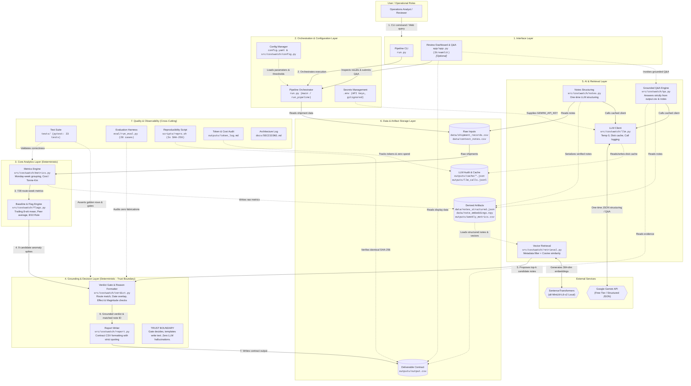

# Routewatch System Design & Layered Architecture

This document provides a comprehensive technical breakdown of the Routewatch system architecture, module decomposition, decision gates, and architectural trade-offs.

---

## 1. Top-to-Bottom Layered Architecture

The system is organized into strictly delineated layers stacked top-to-bottom. Deterministic analytics and decision logic are separated from AI retrieval and persistence by an explicit **Trust Boundary**.

### Mermaid Source (`docs/diagrams/system_architecture.mmd`)

---

### How a Request Flows (Step-by-Step)
1. **User Request / Invocation**: An analyst runs `python run.py` via CLI or opens the Streamlit operations dashboard (`app/app.py`).
2. **Orchestration & Parameter Loading**: The orchestrator initializes, parses runtime flags, loads `config.yaml` into an immutable `Config` dataclass, and pulls raw inputs from `data/`.
3. **Weekly Metrics Aggregation**: `metrics.py` groups 2,940 shipment records into Monday-aligned weeks, calculates weighted $\text{Rate} = \frac{\sum \text{Cost}}{\sum (\text{Qty} \times \text{Dist})}$, and outputs all 728 route-weeks to `outputs/weekly_metrics.csv`.
4. **Baseline & Anomaly Filtering**: `flags.py` calculates trailing 8-week prior averages (strictly past weeks, no look-ahead) and peer tier averages (excluding self). The dual-condition threshold (`vs_own >= +8%` AND `vs_similar >= +10%`) isolates the 9 candidate anomaly spikes.
5. **Candidate Note Retrieval (Proposal)**: `retrieval.py` pre-filters the context notes by route metadata and uses cosine similarity over local `all-MiniLM-L6-v2` embeddings to rank potentially relevant disruption notes.
6. **Deterministic Gate Evaluation (Decision)**: `verdict.py` tests proposed notes against strict deterministic gates (route applicability, active time window overlap, cost-increase effect, and magnitude tolerance). The gate strictly decides justification; if a note passes, it fills a verified template; if none pass, it outputs an honest unexplained verdict with blank note ID.
7. **Contract Deliverable Output**: `report.py` formats the results with Python's standard `csv` module (ensuring strict quoting) into `outputs/output.csv`, sorted deterministically by `week_of` then `route`.
8. **Operations Review & Grounded Q&A**: The analyst inspects results and trajectory curves in Streamlit, or asks natural-language questions through `qa.py`, which restricts answers strictly to the proven evidence.

---

## 2. Supporting Diagram: Verdict Decision Gate Flow

This diagram illustrates how an individual flagged candidate route-week is evaluated by the deterministic applicability gate.

### Decision Logic:
- **Rule 1 (Route Scope)**: Note must apply to the specific corridor or `ALL` routes, and `affects_dataset` must be `True`. Note N004 (toll on non-dataset stretch) is rejected here.
- **Rule 2 (Time Window)**: The candidate Monday–Sunday week must strictly overlap the note's active period. Expired notes (e.g. N001 evaluated after March 8) are rejected here.
- **Rule 3 (Effect Check)**: Note effect must be `cost_increase`. Notes reporting stable demand (N006), cost absorption (N010), road resurfacing (N007), or normal recovery (N009) are rejected here.
- **Rule 4 (Magnitude Check)**: For notes specifying an expected surge (e.g. N003: 5–7%), increases exceeding tolerance ($> 17\%$) are flagged as unexplained.
- **Outcome**: Any passing note yields `No (justified)` with `matched_note_id`. If all notes fail, verdict is `Yes` with blank `matched_note_id`.

---

## 3. Supporting Diagram: Deployment & Runtime Topology

Where processes execute:
- **Local Host Workstation**: All data processing, vector embeddings inference (`all-MiniLM-L6-v2`), baseline math, gate verification, and Streamlit UI execute 100% locally on CPU without external cloud compute dependencies.
- **External LLM Service**: Google Gemini API is accessed strictly via HTTPS for one-time note structuring (temperature 0, cached to disk) and interactive natural-language Q&A. Production pipeline execution requires 0 active API calls.
- **Remote Git Repository**: Git remote (`https://github.com/getdownandcode/Routewatch.git`) tracks code, configuration, verified JSON schema, test cases, and deliverables.

---

## 4. Subsystem Component Matrix

| Layer | Module / File | Responsibility | Inputs | Outputs |
|:---|:---|:---|:---|:---|
| **1. Interface** | `run.py` | CLI argument parsing, pipeline trigger, 3-run repro check | CLI flags (`--repro`, `--config`) | Console status, exit codes |
| **1. Interface** | `app/app.py` | Streamlit review dashboard, trajectory curves, Q&A | `output.csv`, `weekly_metrics.csv` | Interactive browser UI (:8501) |
| **2. Orchestration** | `run.py (main)` | Coordinates end-to-end execution across domain services | User parameters, file paths | Process coordination |
| **2. Configuration** | `config.py` & `config.yaml` | Centrally defines thresholds, paths, and hyperparameters | `config.yaml` | Immutable `Config` instance |
| **3. Analytics** | `src/costwatch/metrics.py` | Groups Mon-Sun shipments, calculates cost per tonne-km | `data/shipment_records.csv` | `DataFrame`, `outputs/weekly_metrics.csv` |
| **3. Analytics** | `src/costwatch/flags.py` | Computes rolling 8-wk baselines, peer avgs, 8/10 flag rule | Weekly metrics `DataFrame` | Flagged `DataFrame` (9 candidates) |
| **4. Decision** | `src/costwatch/verdict.py` | Deterministic applicability gate & verified template reasons | Candidate row, retrieved notes | `VerdictResult` instance |
| **4. Decision** | `src/costwatch/report.py` | Writes deliverable CSV in exact contract column order | List of `VerdictResult` | `outputs/output.csv` |
| **5. AI & Retrieval** | `src/costwatch/notes.py` | Structures context notes into verified JSON schema | `context_notes.csv` | `data/notes_structured.json` |
| **5. AI & Retrieval** | `src/costwatch/retrieval.py` | Local vector search (384-dim embeddings + cosine ranking) | Query string, route, week_of | Ranked `List[(StructuredNote, score)]` |
| **5. AI & Retrieval** | `src/costwatch/llm.py` | Gemini API client with SHA-256 disk cache & token audit | Prompt string, schema | Structured JSON dict, call log |
| **5. AI & Retrieval** | `src/costwatch/qa.py` | Grounded Q&A service restricted strictly to output evidence | Natural-language query | `(answer, cited_rows, cited_notes)` |
| **6. Persistence** | `data/`, `outputs/` | File-based persistence of inputs, vectors, cache, and outputs | File read/write operations | Persistent storage assets |
| **7. Quality** | `tests/`, `eval/`, `scripts/` | Regression test suite (23 tests), 28-case eval, 3x repro check | Pipeline functions, test fixtures | Test reports, audit markdown |

---

## 5. Architectural Design Decisions & Trade-Offs

### Decision 1: Deterministic Applicability Gate vs. Generative LLM Verdicts
- **Decision**: Final verdicts (`Yes` vs. `No (justified)`) and note matches are determined strictly by a deterministic Python rule gate (`check_note_applicability`), not by an LLM prompt.
- **Why**: In financial and freight cost auditing, generative models hallucinate justifications when presented with vaguely related notes. A deterministic gate guarantees that a note is only accepted if the route matches, the date window overlaps, the effect is an actual cost increase, and the surge magnitude is reasonable. Failed checks score 100% on the fabrication audit.

### Decision 2: Template-Based Reasons vs. Free-Form LLM Text
- **Decision**: Reasons are generated by filling structured fields into verified templates (`Matches note {id} dated {date}: {paraphrase}...`).
- **Why**: Eliminates non-deterministic wording shifts, guarantees CSV syntax safety (no unescaped commas breaking column parsers), and ensures the reason text strictly states verified facts without synthetic extrapolation.

### Decision 3: Local SentenceTransformers & Numpy Cosine Search vs. Vector Database
- **Decision**: Used `all-MiniLM-L6-v2` locally with numpy dot product for cosine similarity ranking instead of deploying Chroma, Pinecone, or Milvus.
- **Why**: The context note corpus is 10 items. Embedding 10 notes takes <1 second and produces a $10 \times 384$ numpy matrix (`30 KB`). Query ranking takes under $0.5\text{ ms}$ on CPU with zero external network calls, zero daemon processes, and 100% offline portability.

### Decision 4: Persistent Disk Caching for LLM Calls
- **Decision**: All LLM calls are hashed by `(model, prompt, temperature)` and cached to `outputs/cache/<hash>.json`.
- **Why**: In production / warm runs, the pipeline requires **0 API calls**, costing ₹0.00 and running in seconds. It also makes outputs 100% reproducible and testable offline.

### Decision 5: Dual-Baseline Candidate Flagging (+8% Own / +10% Peer)
- **Decision**: An anomaly requires both a significant surge against the corridor's own 8-week history ($\ge +8\%$) AND against peer routes in the same distance tier ($\ge +10\%$).
- **Why**: Short routes (Mumbai-Pune and Delhi-Jaipur) have only 1 peer in their length bucket, making peer comparisons sensitive to single-route variations. The dual-gate prevents market-wide general trends from being falsely flagged as route-specific anomalies while catching genuine corridor disruptions.
